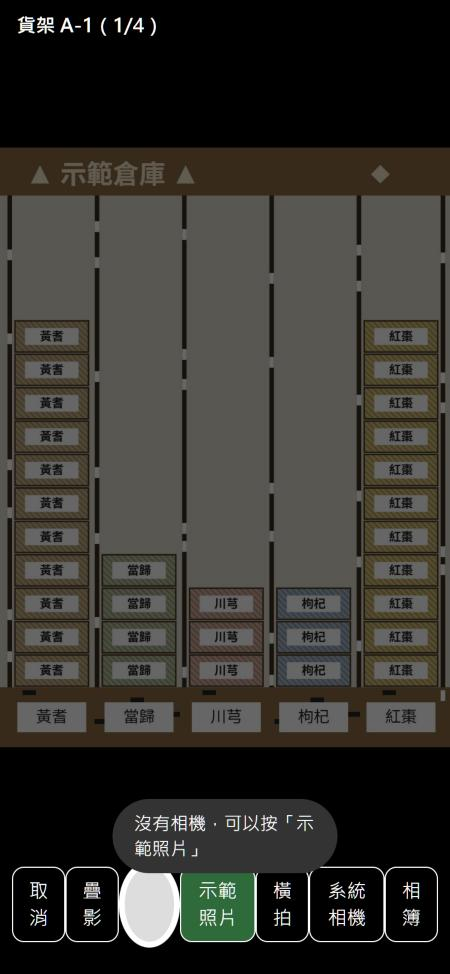
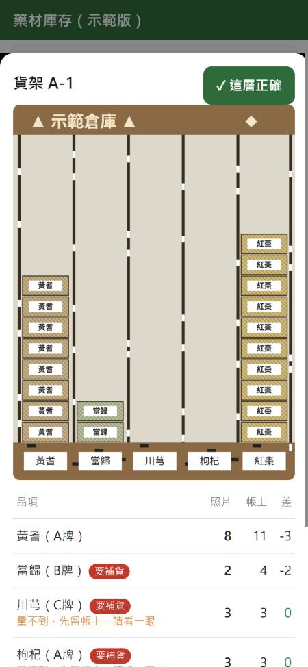
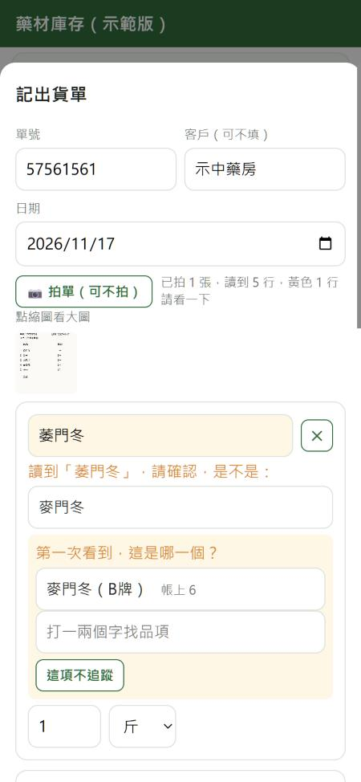

# Shelf Snap Inventory：拍貨架就盤點（藥材倉庫示範版）

在貨架前拍一張照片，App 就估出每種藥材還剩幾袋。出貨單和標籤上的字也是在手機裡直接辨識，全程離線。

*An offline PWA for a herbal-medicine warehouse: it estimates stock from a shelf photo and reads delivery slips and expiry labels with on-device OCR. Everything runs in the phone's browser, with no server and no paid API.*

藥材倉庫是第一個實際使用的場景。同樣的方法也適用在其他沒有條碼、包裝固定、一疊一疊堆放的貨品，例如袋裝乾貨、茶葉、米、紙箱。

**線上試用：https://waynelim1983-afk.github.io/shelf-snap-inventory/**

電腦或手機都能開，不用裝任何東西。第一次打開會自動建立虛構的品項、貨架和照片。在相機畫面按「示範照片」就能試，沒有相機也可以。資料只存在你的瀏覽器裡。第一次讀字會先下載約 30 MB 的辨識模型，之後離線也能用。

| 拍貨架 | 照片估數量 | 讀出貨單 |
|---|---|---|
|  |  |  |

## 功能

- **拍照盤點**
  - 每層貨架有一張基準照，上面框出每種藥材的位置。
  - 再拍一張時，程式先把新照片對齊基準照，再量每一疊的高度，依比例估出袋數。
  - 人只要修正不對的數字。
- **讀出貨單**
  - 拍下紙本出貨單，在手機上辨識單號、品名和斤兩，換算成包數後扣庫存。
  - 讀錯的字修正一次就記住，下次自動改對。
  - 可以先連拍好幾張，讓 App 在背後慢慢讀，有空再一張張確認。
- **讀標籤日期**：拍進貨標籤，自動找出有效日期；快到期的批次會列在首頁。
- **其他**
  - 進貨、退換貨、零售／損耗。
  - 補貨清單：低於安全量的品項會依供應商分組。
  - 匯出／匯入完整備份（含照片）。

## 技術

- **原生 JavaScript**：全部寫在一個 `index.html` 裡，沒有框架、沒有建置步驟。
- **離線 PWA**：Service Worker 先抓網路、抓不到用快取，裝到主畫面後完全離線可用。
- **資料**：localStorage 存帳，IndexedDB 存照片。
- **文字辨識**：用 [ONNX Runtime Web](https://onnxruntime.ai/) 在瀏覽器裡跑 PP-OCRv3（文字偵測＋辨識模型）。
  - Service Worker 會補上 COOP/COEP 標頭，讓頁面能用多執行緒 WebAssembly，在靜態網頁空間上也能多執行緒。
- **數量估算**：自己寫的影像處理。
  - 先用邊緣圖的正規化相關係數（NCC）由粗到細對齊兩張照片，再從框的上緣往下找第一段有袋子紋路的位置，算出堆高。
- **自動對焦**：這支手機的網頁相機沒有自動對焦，所以自己掃過幾個對焦距離，挑畫面最清楚的位置。

## 設計決定

- **為什麼離線**
  - 倉庫用的是一支沒有門號的舊手機，網路不一定穩。
  - 資料也不想傳到別人的伺服器。
  - 所以沒有後端，也不呼叫付費 API，用多久都不花錢。
- **為什麼不用 AI 認藥材的外觀**
  - 乾燥藥材裝袋後外觀很像，同一種藥材換個品牌包裝就不一樣，認錯的代價又高。
  - 所以「哪一格是什麼」由人框一次就好；程式只負責量那一疊變高還是變矮。這樣簡單、可預期，錯了也看得出來。
- **怎麼在舊手機上變快**：在一支 2018 年、2 GB 記憶體的手機上實測每一步花多久，再把慢的地方移出等待時間。
  - 照片壓縮成 JPEG 要 5 到 13 秒，改到背後做，按快門後約 1 秒就看到估算結果。
  - 取相機畫面從 0.7 秒降到 0.03 秒。
  - 一張出貨單從開始讀到讀完大約 8 秒。
- **照使用回饋改**：一個月內改了 80 多版，每一版都是使用的人遇到問題、提出想法之後改的。例如：
  - 「按快門沒反應」→ 加上閃白和震動。
  - 「拉對焦桿好麻煩」→ 改成自動對焦。
  - 「一次拍好幾張單」→ 加上連拍和背後辨識。

## 自己跑

```bash
python -m http.server 8080
```

打開 http://localhost:8080 即可。辨識模型和 ONNX Runtime 已放在 `vendor/`，不需要網路。

第三方元件：`vendor/` 裡的 ONNX Runtime Web 採 MIT 授權；PP-OCRv3 模型來自 PaddleOCR，採 Apache-2.0 授權。

這是示範版。實際使用的版本在私人倉庫，裡面有真實的品項和照片，所以沒有公開。
